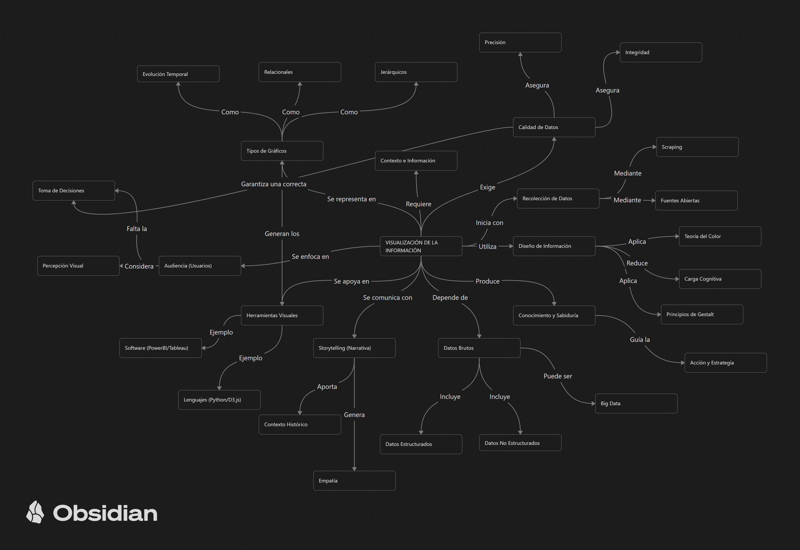

# Evaluación Sumativa Unidad 1: Visualización de Datos

## Información General
- **Nombre:** Vicente Jesús Liapiz Ávila
- **Asignatura:** Visualización de Datos
- **Carrera:** Ingeniería
- **Institución:** INACAP (Sede Renca)
- **Fecha:** Septiembre 2026

## Descripción del Proyecto
Este repositorio contiene la bóveda (Vault) de Obsidian y los documentos correspondientes a la evaluación de la Unidad 1. El proyecto busca construir una red de conocimiento interconectada basada en el libro *"Visualización de la información: De los datos al conocimiento"* de Ignasi Alcalde Perea, aplicando conceptos teóricos a casos reales y al desarrollo técnico.

## Estructura de la Vault (`VisualizacionDatos_Liapiz_Vicente`)
- `/MOC`: Contiene el Mapa General (centro de navegación).
- `/Conceptos`: Almacena las 20+ notas conceptuales requeridas, interconectadas.
- `/Referencias`: Notas sobre fuentes bibliográficas y el libro base.
- `/Reflexiones`: Ensayos y análisis de gestión del conocimiento.
- `/MapaConceptual`: Estructura base para el mapa integrador.
- `/Informe`: Documento final unificado con análisis de gráficas reales y ensayos.
- `/Evidencias`: Capturas de pantalla (Graph View e Historial de Commits).
- `/Recursos`: Archivos multimedia de apoyo.

## Captura del Graph View
*(Reemplazar la imagen en la carpeta Evidencias al finalizar)*

## Aprendizajes Obtenidos
La construcción de esta base de conocimiento demuestra cómo los datos aislados, mediante herramientas como Obsidian y Git, pueden estructurarse en información valiosa. Integrar conceptos de diseño visual mejora drásticamente la capacidad de comunicar insights, lo cual es fundamental en la arquitectura y análisis de sistemas complejos.
